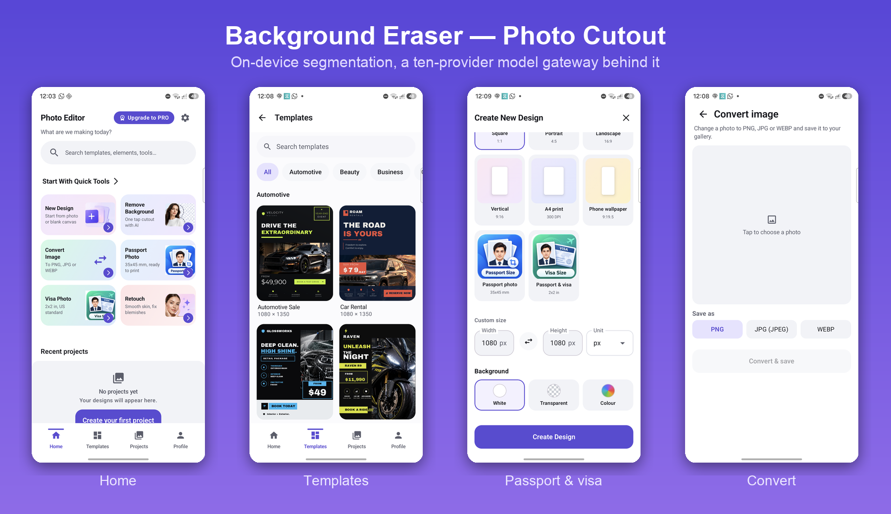

# Portfolio — Mujahid Khattak

AI engineer, Android and backend. CEO & Founder at Tackle Bytes, Peshawar.

This repository is an index. Each project below has a page describing what it does, what was hard about it, and how it was solved. Source for the commercial work stays private.

📧 [mujahidmskhan112@gmail.com](mailto:mujahidmskhan112@gmail.com)

---

## Shipped

### [AI Photo Editor — Background Eraser Photo Cutout](projects/ai-photo-editor.md)

Live on Google Play. One-tap background removal running ML Kit subject segmentation **on the device**, with a FastAPI gateway behind it fronting ten model providers for generative replace, inpainting, upscale and text-to-image. Self-hosted BiRefNet on a RunPod GPU worker.

`Kotlin` `Jetpack Compose` `ML Kit` `FastAPI` `Firebase` `Play Billing` `AdMob`

[Play Store](https://play.google.com/store/apps/details?id=com.photostudio.aiphotoeditor) · [Read the case study →](projects/ai-photo-editor.md)

---

### [Boat Escape](projects/boat-escape.md)

Live on Google Play. Logic puzzle game — unblock the boats to clear the harbour. Full ad lifecycle: App Open with session pacing and frequency caps, UMP consent, and a startup surface that never blocks first play.

`Kotlin` `Jetpack Compose` `AdMob` `UMP`

[Play Store](https://play.google.com/store/apps/details?id=com.boat_puzzle.boatescape) · [Read more →](projects/boat-escape.md)

---

## In development

### [Expense Tracker](projects/expense-tracker.md)

Offline-first personal finance tracking. Built in phases, each with its own audit and validation pass.

`Kotlin` `Jetpack Compose` `Room`

---

## Earlier work

University and self-taught Android projects, 2021. Java, pre-Compose. Kept for history rather than as a sample of current work.

| Project | What it is |
|---|---|
| **[Blood Bank Management](projects/blood-bank.md)** | Donor registry with sign-up/sign-in, donor search, donation records and profiles |
| Plants Nursery | Plant catalogue and ordering |
| IVAP COVID-19 | Information app built during the pandemic |
| Mechanic App | On-demand mechanic booking |

Plus focused practice on RecyclerView, Retrofit + Glide, SQLite, Services, BroadcastReceivers, Google Maps and AdMob integration.

---

## Stack

**On-device ML** — ML Kit (subject segmentation, face detection), Play Services optional-module lifecycle
**Model serving** — FastAPI, provider abstraction over BiRefNet / Replicate / fal / OpenAI Images / Bria / PhotoRoom, self-hosted GPU inference, async job orchestration
**Android** — Kotlin, Jetpack Compose, Coroutines/Flow, Room, CameraX, Play Billing, Play App Signing, AdMob, UMP
**Backend & infra** — Python, Docker, Railway, Firebase Auth, Firestore, GitHub Actions
**Practice** — measure on the device before changing behaviour, pin defects with tests that carry a number, feature flags over branches
