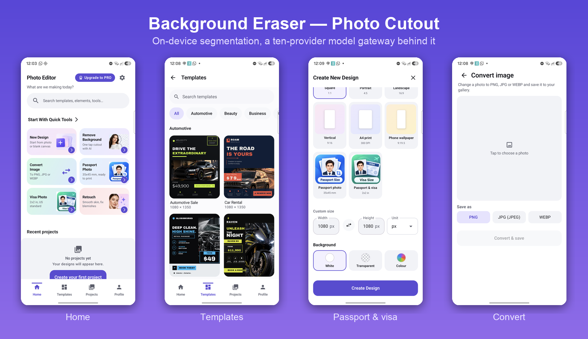
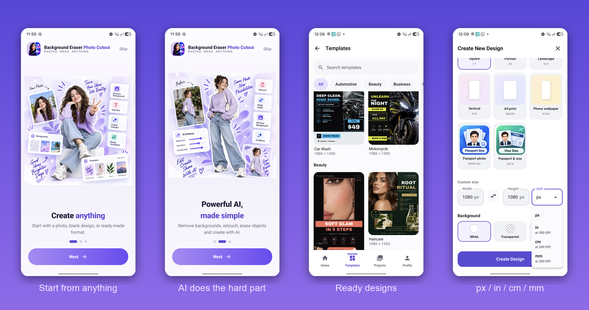
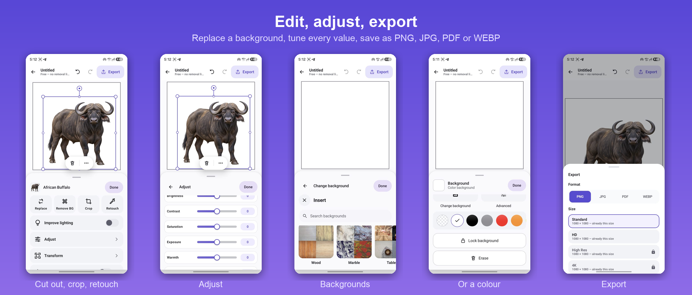
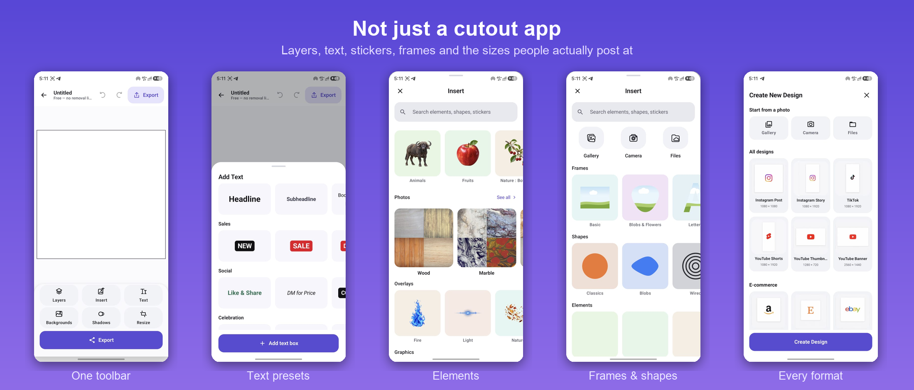

# AI Photo Editor — Background Eraser Photo Cutout

**Live on Google Play** · [Store listing](https://play.google.com/store/apps/details?id=com.photostudio.aiphotoeditor)



A photo editor built around segmentation and generative editing. Kotlin and Jetpack Compose on the device, FastAPI on the server, with inference split between the handset and a model gateway depending on what the user is entitled to and what the device can actually do.

---

## What it does

- **One-tap background removal** — free and unlimited, running entirely on the device
- **HD removal** — cloud BiRefNet for users who want cleaner edges
- **Passport and visa photos** — 35×45 mm and 2×2 in canvases at 300 DPI, print-ready
- **Format conversion** — PNG, JPG, WEBP with transparency handling
- **Generative editing** — background replace, inpainting (magic erase), upscale
- **Layer editor** — layers, transforms, masks, filters, shadows, text and templates
- **Export** — PNG, JPG, PDF or WEBP, with resolution tiers from Standard to 4K



### Editing

Per-layer tools — replace, cut out, crop, retouch — plus adjustments for brightness,
contrast, saturation, exposure and warmth. Backgrounds can be swapped for a stock
texture, set to a flat colour, made transparent, or locked so a stray drag cannot
move them.



### Designing

The cutout is the entry point, not the whole product. A canvas carries layers, text
presets written for the people actually using it (`NEW`, `SALE`, `DM for Price`),
a stock library of elements, photos, overlays, frames and shapes, and the output
sizes people post at — Instagram, TikTok, YouTube, Amazon, Etsy, eBay.



---

## Architecture

### On the device

ML Kit Subject Segmentation runs the free cutout locally. Nothing is uploaded, it works on a plane, and a run costs nothing — which is why the free tier could be made unlimited rather than metered.

### In the cloud

A provider registry fronting ten model backends, resolved per operation and per tier behind a single `AIProvider` interface:

| Operation | Endpoint | Backends |
|---|---|---|
| Background removal | `POST /v1/remove-background` | BiRefNet (self-hosted), Bria, PhotoRoom, rembg |
| Generative replace | `POST /v1/ai-replace` | Replicate, fal, kie |
| Inpainting | `POST /v1/magic-erase` | Replicate inpaint |
| Upscale | `POST /v1/enhance` | Replicate upscale |
| Text-to-image | `POST /v1/generate` | OpenAI Images, fal, kie |

BiRefNet runs on a RunPod GPU worker built and deployed as part of the project rather than rented per call. Because every vendor sits behind one interface, swapping a provider is a configuration change and a vendor outage is not an outage.

Around the models: async generation jobs with polling and reconciliation, credit metering per plan, rate limiting, content moderation, and an in-app reporting flow for AI-generated results.

---

## Four problems worth the time they took

### 1. A readiness check that lied

ML Kit's segmentation model is an optional Play Services module, fetched on first use. ML Kit exposes no "is it ready" API, so readiness was inferred by segmenting a 64×64 grey square and treating any non-`UNAVAILABLE` outcome as success.

It does not work. Measured on a physical device:

```
20:25:48  probe reports ready, 1198 ms
20:27:58  real cutout on a real photo → MlKitException UNAVAILABLE (code 14)
```

A check that can pass while the thing it checks is absent is worse than no check at all, because it is what tells the warm-up to stop trying.

Replaced with Play Services' own `ModuleInstall` API. `areModulesAvailable` gives a real answer instead of an inference, and `installModules` actually **starts** the download — which the probe never did, so the module was only ever fetched at the moment a user was already waiting for it.

```
tier=STANDARD engine=local_mlkit source=900x1600
segmented: subjects=1
success: 1 subject(s)
```

First cutout, measured on the same device afterwards: **1.2 seconds**.

### 2. Choosing an engine without lying to the user

Cloud removal gives better edges. The on-device model is free and instant once the module is present. The rule deciding between them had been reversed twice in this codebase, plausibly each time.

It now lives in one pure function with no I/O, pinned by six tests. The rule is one line: **escalate free to paid, never the reverse.**

- A standard request is promoted to the cloud only when the on-device module has not yet proven itself **and** the user already holds the paid entitlement — so being routed to the better engine can never surface a paywall
- A paid request is never quietly downgraded to the device model; the failure is surfaced and the choice left with the user
- The kill switch beats both

Extracting it was the point. Five booleans and no I/O can be pinned by a test; a rule spread across call sites can only be pinned by memory, and memory is what had already failed twice.

### 3. Withdrawing a generative feature without deleting it

A Play policy enforcement required removing all AI-generated content from a live app, quickly. Deleting the code would have turned restoring it into a rewrite.

Instead: one compile-time flag, nineteen guards, and a router-level dependency returning 503. Every entry point — home, editor, menus, global search, deep links, saved projects — resolves through that flag, so no path can reach generation however it was started. A test asserts the route stays mounted but refuses, which is what stops the endpoint from silently disappearing instead of deliberately declining.

Restoring the feature is one boolean.

The same enforcement required in-app reporting for AI results. That shipped too: a reason taxonomy, optional free-text detail, Firestore-backed, with **no auth tokens, no credentials, and no report text in logs** — a six-character uid prefix is all that is recorded.

### 4. Measuring before building

GA4 over one week: 2,562 first opens → 1,991 reached home → 1,041 opened the editor → 49 completed an export.

People were spending **two minutes** in the editor and leaving with nothing. That is not a discovery problem, it is a completion problem, and no amount of marketing fixes it.

Three causes found:

1. A paywall sitting inside the background-removal flow — removed
2. The model download above — fixed
3. Two of five live ad headlines promised a PNG converter the app did not have

The third was not a code problem at all. The fix was to build the converter.

---

## Testing

392 unit tests on the release variant. The ones that matter are not coverage padding — they pin specific defects with specific numbers. `PinchFocalSolveTest` asserts that the old pinch solve drifts by more than 100 px once the bottom sheet is raised, so the coordinate-space bug cannot return quietly. `RemovalTierPolicyTest` pins the escalate-never-downgrade rule in both directions.

---

## Stack

`Kotlin` `Jetpack Compose` `Coroutines/Flow` `ML Kit` `CameraX` `Room` `Play Billing` `Play App Signing` `AdMob` `UMP` `FastAPI` `Python` `Firebase Auth` `Firestore` `Docker` `Railway` `RunPod`

---

## Screens

Full-size captures in [`screens/`](screens).

| | |
|---|---|
| [Home](screens/03-home.png) | Six tools on one screen |
| [Templates](screens/04-templates.png) · [Beauty](screens/05-templates-beauty.png) | The ready-made design library |
| [Convert](screens/06-convert.png) | PNG, JPG or WEBP |
| [Passport & visa](screens/07-passport-visa.png) | 35×45 mm and 2×2 in presets |
| [Units](screens/08-units.png) | px, inches, cm, mm at 300 DPI |
| [Onboarding](screens/01-onboarding-create.png) · [AI](screens/02-onboarding-ai.png) | First run |
| [Layer tools](screens/layer-tools.png) · [Adjust](screens/adjust.png) | Per-layer editing |
| [Backgrounds](screens/backgrounds.png) · [Colour](screens/background-colour.png) | Swap or fill the background |
| [Text](screens/text.png) · [Elements](screens/elements.png) · [Frames](screens/frames-shapes.png) | The design library |
| [Canvas](screens/canvas.png) · [Formats](screens/design-formats.png) · [Export](screens/export.png) | Build and ship |
