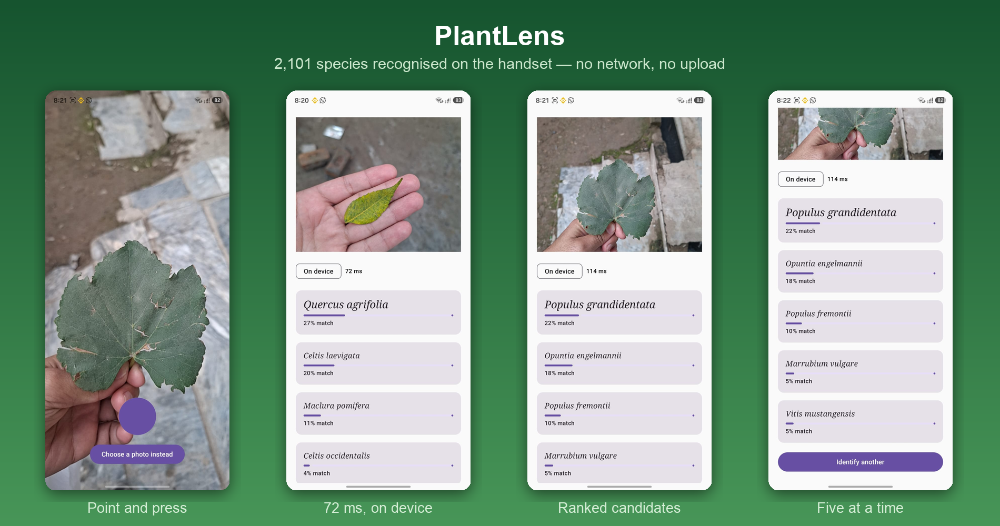

# PlantLens

**In development** · Kotlin, Jetpack Compose, TensorFlow Lite

Point a camera at a plant and get a name. The model runs on the handset — nothing is uploaded,
it works with no signal, and a run costs nothing.



---

## Measured on a device

| | |
|---|---|
| Model | Google AIY Vision Classifier — Plants V1 |
| Species | 2,101 |
| Size | 4.8 MB |
| Cold start | model ready in **700 ms** |
| Inference | **72–114 ms** |

The runtime is not bundled. TFLite arrives through Play Services, which keeps roughly 3 MB out
of the download and lets the runtime update without an app release.

---

## Three decisions made before the first screen was drawn

### The engine choice is a pure function

`IdentifyPolicy` takes five booleans and returns a plan. No I/O, eleven tests.

On-device answers first — it is free, offline and sub-second. The cloud is the exception: a
weak local result, or a user explicitly asking for the better answer. Never the reverse, and
never silently.

This is a lesson carried over rather than learned here. In a sibling project the same decision
lived scattered across call sites, was reversed twice, and cost a round of device testing each
time to notice.

### The answer carries where it came from

```kotlin
data class Identification(
    val candidates: List<Candidate>,
    val source: IdentifySource,   // ON_DEVICE or CLOUD — reaches the screen
)
```

The chip in the screenshots is not decoration. An on-device guess at 27% must never be
rendered as though it came from the better model. In a plant app someone may water, prune or
eat based on the answer.

### Confidence is shown raw

27% is displayed as 27%. Rescaling a weak softmax into a confident-looking number is the
single easiest way to make this kind of app dangerous.

---

## A bug the device found

Pointed at a room rather than a plant, the first build reported:

```
top=None  conf=0.87
```

`None` is the model's 2,102nd class — its way of saying *this is not a plant*. The model was
working. The app was rendering "None — 87% match" as the answer.

The fix moved candidate selection into `CandidateRanking`, a pure function with eight tests: a
winning background class returns an **empty list**, which the UI already renders as "I could
not place this one". Listing the runners-up underneath would have been the app overriding the
model to avoid an empty screen.

---

## What the device also found: the model is North American

The leaves in the screenshots were photographed in Peshawar. Every candidate the model returned
is a US or Canadian species — coast live oak, Osage orange, bigtooth aspen, a Texas grape, an
Arizona cactus offered for a maple-shaped leaf.

AIY Plants V1 is trained on data heavily skewed to North America. The pipeline is correct and
the latency is good; the species coverage does not match where the app is being used. Top
confidences of 22–27% are the model saying so.

This is why the cloud tier exists in the design, and it is the next thing to build. Finding it
in week one, on real leaves, is the point of testing on a device instead of a sample image.

---

## Status

- [x] Project, Compose UI, CameraX capture with correct rotation
- [x] System photo picker — no gallery permission
- [x] On-device classifier, geometry read from the model rather than hard-coded
- [x] `IdentifyPolicy` and `CandidateRanking`, 19 tests
- [x] Firebase Analytics and Crashlytics
- [ ] Cloud tier with global species coverage
- [ ] Common names — the model emits Latin binomials, which is not an answer for a gardener
- [ ] Leaf disease detection
